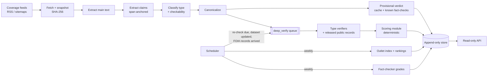

# TrustBuilder: Plan

**Status:** draft for approval, 2026-10-26. Nothing is scaffolded yet.
**Naming:** the planning docs call this product **Trust Engine**. It is the same product. Code, packages, env vars and the API all use **TrustBuilder**.

Sources read: [Master Summary](https://docs.google.com/document/d/1CGVn87AqEwJUjDogP3YRqhXUvdDChkwFeulv6GMOAZE/edit) · [Build Plan](https://docs.google.com/document/d/1JZMMELoP20OE8294TgrmzCKzhiCoY_GeKMhAk-yatgA/edit) · [Brand Book](https://docs.google.com/document/d/1yFGwn7Tl4sRSKOeQSAWttRabIrvvdgVZO-Twc4M08OE/edit) · [Competitive Landscape](https://docs.google.com/document/d/1kAllUE1Ferwkl_GCg8a8bkOhu2f6u1V9zMcCt7nW5og/edit) · [Competitor Research](https://docs.google.com/document/d/1WWjJfXD2mEnXkj4Usn99dxQ9mfoP8rt2nCZ5t1VvdyI/edit) · [Branding](https://docs.google.com/document/d/1PlNqFk_OqveumH9qciox_CUDLgJotwSFS5ThNK_-lQ8/edit)

---

## 1. What we're building

TrustBuilder is an API that sells trust scores per claim and per outlet. It ingests articles from the outlets it covers, splits them into discrete claims, checks each claim against primary sources and existing fact-checks, and records a confidence-scored verdict with receipts. Customers never submit URLs. A dashboard, if we build one, is a read-only view of scores for API customers.

The value is the record, not the single check. Every verdict, article check, outlet index and fact-checker grade is a timestamped row that is never overwritten. That history is the moat the Competitive Landscape identifies: per-URL time series (F3), outlet scores built from verdicts (F4), and fact-checkers graded on outcomes (F5). Nobody else offers these, and they can't be rebuilt after the fact.

**Ground rules (apply from the first commit):**

1. **No invented sources or scores.** Until real verification is wired up, the API serves fixture data that labels itself as fixture data on every response (§7). Fixtures never name a real outlet, agency, person or fact-checker.
2. **Secrets come from environment variables only.** `.env` is git-ignored, `.env.example` holds names and no values, and CI never needs a real key.
3. **Score claims and outlets, not people.** Author ratings are a non-goal (Build Plan §2.2). Outlet scores are built only from claim verdicts with receipts.
4. **Reimplement Frank Investigator's ideas but don't copy its code.** It is AGPL-3.0. Loki and OpenFactCheck are MIT and safe to reuse with attribution.

---

## 2. Architecture

### 2.1 The API only reads stored records

The pipeline writes append-only records. The API reads them. No API request triggers fetching, LLM calls or searches.

The Build Plan's hybrid model was argued partly from on-demand URL checks ("coverage of arbitrary URLs"). Without URL submission, the fast pass runs **when an article is ingested**, not when a customer asks. Its job is freshness: a newly published article gets a provisional score within minutes. This has three benefits:

- API latency and cost are flat and predictable.
- Customers can't run up our verification costs.
- Every response is reproducible, because it comes from a stored row.

### 2.2 Hybrid verification: three tiers

| Tier | Triggered by | Target latency | Writes |
|---|---|---|---|
| **Provisional** | A new article arrives from a coverage feed | Minutes after publication | `verdict_versions` (stage `provisional`), `article_checks` |
| **Deep** | A queued job per new or stale canonical claim | Minutes to hours | `verdict_versions` (stage `deep`), `evidence_*` |
| **Scheduled** | Per-type freshness windows, dataset updates, FOIA records arriving, weekly batches | Days to months | `verdict_versions` (stage `recheck`), `outlet_index_snapshots`, `grader_score_history`, `ranking_publications` |

Rules carried over from Build Plan §3: a claim with a fresh canonical verdict is served from cache; deep work is deduplicated per canonical claim, so each claim is paid for once; re-check frequency depends on how volatile the claim is.



### 2.3 Claim types and how each is checked

| Type | Primary evidence path | Notes |
|---|---|---|
| `statistic` | Official datasets (statistics offices, FRED, BLS, Census, World Bank, Eurostat) | Check value, unit, period, geography and definition. Flag cherry-picked periods. Re-check when the dataset updates. |
| `quote` | Transcripts, official records, video captions, earliest occurrence | Check wording and context (misattribution, truncation). |
| `scientific` | OpenAlex, Crossref (including retractions), PubMed, Semantic Scholar | Prefer systematic reviews. Re-check slowly. |
| `historical_event` | National archives, digitized newspapers; Wikipedia/Wikidata only as pointers | Re-check rarely. |
| `opinion`, `prediction` | None. Classified as not checkable | Predictions are tracked as "pending resolution". |

The `claim_types` reference table keeps the Build Plan's full list of codes. Verifiers ship one at a time in Build Plan Phase 3 order: statistics, quotes, science, then history.

### 2.4 FOIA as the data engine

FOIA requests take weeks to months, so they can't feed the provisional or deep pass directly. FOIA reaches verdicts in two ways:

1. **Already-released records.** Agency reading rooms, published FOIA logs and request archives are searched during deep verification like any other primary source (`source_tier = primary_record`).
2. **New requests.** When a claim's evidence is thin and a specific record would settle it, the system drafts a request. A human approves and files it. The request is tracked as a long-running workflow with statutory deadlines (federal agencies have 20 working days to make a determination), fees, appeals and correspondence. When records arrive, they are stored as evidence and trigger a re-check that writes a new verdict version with `change_reason = primary_record_released`.

Until then the claim stays flagged `evidence_strength = thin`, with a pointer to the pending request. That makes "we've asked for the record" a visible state rather than a hidden one.

---

## 3. Proposed stack

| Layer | Choice | Why | When decided |
|---|---|---|---|
| Language | **Python 3.13 for everything** (API + pipeline) | The extraction and NLP tooling is Python (Trafilatura, PyMuPDF). One language suits a single builder. The Build Plan's TypeScript web app isn't needed for an API-first product. | Now (see Q1) |
| API | **FastAPI + Pydantic v2** | Typed responses; generates the OpenAPI spec the Build Plan requires by Phase 5 | Now |
| Config | pydantic-settings, environment variables only | Keeps secrets out of the repo | Now |
| Tooling | uv, ruff, mypy, pytest, GitHub Actions | Fast, standard | Now |
| Database | **Postgres 16 + pgvector**, SQLAlchemy 2 + Alembic | History and vectors in one place. Append-only enforced by triggers and role grants from the first migration. | Phase 0 (S0) |
| Object storage | S3-compatible (Cloudflare R2 in production, MinIO locally), keys are SHA-256 of content | Immutable, dedupes identical content | Phase 0 (S0) |
| Jobs / workflows | **Temporal** vs. a Postgres-backed queue (Procrastinate) | Temporal's durable timers suit FOIA deadlines and re-check schedules. A Postgres queue needs no extra infrastructure and enqueues in the same transaction as the write. This replaces Celery + Redis as the Build Plan's alternative. | Phase 0 spike (S5) |
| Fetch / extract | httpx, then Trafilatura, with Readability as fallback and Playwright as a gated fallback. PyMuPDF/pdfplumber for PDFs. | Per Build Plan | Phase 0 bake-off (S2) |
| LLM | **Claude via the official `anthropic` Python SDK.** Structured outputs parsed into Pydantic models for extraction, classification and stance. A top-tier model for extraction and stance judging; a small, fast model for classification and query generation. The Message Batches API (async, half price) for scheduled re-checks and backfills. Prompt caching on stable system prompts. | Structured outputs remove parsing failures. Batches cut the cost of the re-check tier. | Phase 0 (S3) |
| Model pinning | Exact model IDs set in env vars and recorded on every `pipeline_runs` row | A model change becomes an explicit, re-evaluated event | Phase 0 |
| Known fact-checks | Google Fact Check Tools API (ClaimReview) | The largest structured index of published fact-checks | Phase 0 (S4) |
| Web search | Provider adapter; pick one provider first | Swappable as cost and quality change | Phase 1 |
| Embeddings | Any strong text-embedding model; model name stored per vector | Only needed for canonical claims | Phase 2 |
| Hosting | Containers on Fly / Render / Railway plus managed Postgres (Build Plan §6) | Low ops | Before first deploy |
| Observability | `pipeline_runs` cost drivers from day one; OpenTelemetry + Sentry later | | Phase 1 |

**Reproducibility.** LLM outputs aren't deterministic, so we never re-run prompts to reproduce a past verdict. A verdict can be reproduced because we store every LLM output it used (extracted claims, stance and quality judgments), and the score is a pure, versioned function of those stored inputs. The LLM never produces the final number.

**Untrusted content.** Fetched pages are data, never instructions. Content goes into prompts inside delimiters, and no tool access is triggered by content (Build Plan §9).

### Where this departs from the Build Plan

| Build Plan | This plan | Why |
|---|---|---|
| Python pipeline + Next.js web app | Python end to end | API-first; no consumer UI. A future dashboard can use the same public API. |
| Live pass at request time | Provisional pass at ingest time; API is read-only | No URL submission (§2.1) |
| Temporal vs. Celery | Temporal vs. Postgres-backed queue | One less service; transactional enqueue |
| n8n + Airtable throwaway spike | Skip it | The Python spike code is reusable and just as fast to write |
| Data model §7 | Same core, plus outlets, coverage, reach, mentions, FOIA, outlet index and rankings | Covers the Oct 25 direction update |

---

## 4. Data model

The core comes straight from Build Plan §7: append-only history, content addressing, versioned prompts, models and methodology on every derived row, and canonical claims shared across URLs. Tables marked **AO** accept only INSERT and SELECT (enforced by trigger and role grant). **New** marks tables the Build Plan doesn't have.

Public IDs are prefixed strings (`clm_`, `art_`, `out_`, `chk_`, `vv_`, `src_`, `org_`). The database uses UUIDv7 internally.

### 4.1 Coverage and ingest

| Table | Key fields | Notes |
|---|---|---|
| `outlets` **new** | id, organization_id → organizations, display_name, coverage_status (active / paused / dropped), added_at | An outlet is a news organization we cover. Ownership lives on `organizations`. |
| `outlet_domains` **new** | outlet_id, domain, valid_from, valid_to | Domains change hands; scores follow the outlet, not the hostname |
| `coverage_feeds` **new** | outlet_id, feed_url, kind (rss / sitemap / api), active, last_polled_at | The only way articles enter the system |
| `documents` | id, outlet_id, url_canonical (unique), first_seen_at, status, recheck_policy | Called "articles" in the API |
| `snapshots` **AO** | document_id, fetched_at, http_status, raw_sha256, text_sha256, storage_key, extractor, render_mode, wayback_url, prev_snapshot_id | One row per fetch. Comparing `text_sha256` detects silent edits. |

### 4.2 Claims

| Table | Key fields | Notes |
|---|---|---|
| `claim_types` | code, checkable, verifier, freshness_days | Reference data (§2.3) |
| `canonical_claims` | id, canonical_text, claim_type, embedding, embedding_model, volatility, next_recheck_at, merged_into_id | The unit we verify. A claim on 20 sites has one history. |
| `claim_instances` **AO** | snapshot_id, canonical_claim_id, text_verbatim, span_start, span_end, text_atomic, claim_type, checkability, salience, entities, extraction_run_id | `text_verbatim` must string-match the stored snapshot at `[span_start, span_end)`. No unanchored claims. |

### 4.3 Evidence, sources and FOIA

| Table | Key fields | Notes |
|---|---|---|
| `sources` | id, name, domain, source_tier, organization_id | Tiers: primary_official, primary_record, peer_reviewed, systematic_review, reputable_secondary, encyclopedic, advocacy, unknown |
| `evidence_items` **AO** | source_id, url, retrieved_at, content_sha256, storage_key, wayback_url, doi / dataset_id, public_record_id, retracted | Our own copy of every piece of evidence |
| `evidence_assessments` **AO** | canonical_claim_id, evidence_item_id, quote_snippet, snippet_offsets, stance, stance_confidence, quality_score, origin_cluster_id, verification_run_id | `quote_snippet` must string-match stored content. `origin_cluster_id` collapses echoes of a single original source. |
| `foia_requests` **new** | id, agency_org_id, subject, request_text, requester_of_record, filed_at, tracking_number, jurisdiction (federal / state), related canonical_claim_ids, fee_cap, status (operational) | One row per request we file |
| `foia_request_events` **new, AO** | foia_request_id, occurred_at, event (drafted, approved, filed, acknowledged, fee_estimate, processing, partial_release, released, denied, appealed, withdrawn), deadline_at, correspondence_storage_key | Full lifecycle with receipts |
| `public_records` **new, AO** | id, foia_request_id (null if found in a reading room), origin_url, agency_org_id, released_at, content_sha256, storage_key, page_count | Released documents; they become `evidence_items` |

### 4.4 Verdicts and article checks (scores over time)

| Table | Key fields | Notes |
|---|---|---|
| `verdict_versions` **AO** | canonical_claim_id, version, created_at, stage, label, score, confidence, evidence_strength, rationale, receipts (jsonb, denormalized), fact_check_inputs (jsonb, with grader weights at the time), scoring_version, model_versions, supersedes_id, change_reason | The core of the long-haul record. Build Plan labels: supported, mostly_supported, mixed, mostly_unsupported, contradicted, unverifiable, misleading_context, outdated. |
| `article_checks` **AO** | document_id, snapshot_id, checked_at, stage, score, band, verdict_version_ids (pinned), flagged_claim_ids, source_ids, summary (counts by label, thin-evidence flags), methodology_version | The Build Plan's `document_reports`. Each row is one check, recording score, flagged claims, sources and date, so the article has a reliability history. |

### 4.5 Reach and third-party mentions

| Table | Key fields | Notes |
|---|---|---|
| `reach_observations` **new, AO** | document_id, metric (views / impressions / est_visits), value, period_start, period_end, provider, method (reported / panel / estimated), uncertainty, observed_at | The outlet-index denominator. Its source and method are always stored and shown. |
| `third_party_mentions` **new, AO** | document_id or canonical_claim_id, mentioning_url, mentioning_outlet_id, mention_type (citation / syndication / repost / social), reach_estimate, observed_at, provider | Extends a claim's exposure beyond first-party views (see Q5 for the interpretation) |

### 4.6 Outlet index and weekly rankings

| Table | Key fields | Notes |
|---|---|---|
| `outlet_index_snapshots` **new, AO** | outlet_id, computed_at, window_start, window_end, status (scored / insufficient_evidence), index, interval_low, interval_high, inputs (articles, claims checked, claims flagged, exposure total and basis, mentions), article_check_ids (pinned), grader_snapshot_id, methodology_version | The outlet time series. It can rise or fall. |
| `ranking_publications` **new, AO** | week_of, computed_at, status (draft / legal_approved / published / corrected), entries (outlet_index_snapshot_id, rank), methodology_version, legal_review_ref, supersedes_id | Corrections add a new row; published rankings are never edited |

### 4.7 Fact-checker grading

Same as Build Plan §7.2: `organizations`, `org_relationships` (**AO**, temporal ownership and funding graph, each edge with an evidence URL), `fact_check_records` (**AO**), `outcomes` (**AO**, with a resolution basis and receipts), `grader_score_history` (**AO**, Beta α/β, track_record_mean, uncertainty, independence_base, triggering_outcome_ids).

### 4.8 Provenance and operations

`pipeline_runs` (kind, model, prompt_version, cost drivers, trace URL), `recheck_jobs` (target, reason, priority, status, workflow_id), `methodology_versions` **new** (version, published_at, description, link to the public methodology page).

### 4.9 Scores over time at a glance

| Entity | Time series | "What did we say on date D?" |
|---|---|---|
| Claim | `verdict_versions` | Latest version with `created_at ≤ D` |
| Article | `article_checks` | Latest check with `checked_at ≤ D`. First row = original verdict. |
| Outlet | `outlet_index_snapshots` | Latest snapshot with `computed_at ≤ D` |
| Fact-checker | `grader_score_history` | Latest row with `computed_at ≤ D` |
| Weekly ranking | `ranking_publications` | Latest row for that week, with its correction chain |

### 4.10 Scoring v0 (proposed; uncalibrated until real data exists)

Every weight and threshold below is a starting point to tune against the golden set, not a validated constant.

- **Claim.** Follows Build Plan §8.1. Each evidence item gets weight wᵢ = quality × directness × recency × reliability. Echoes of one origin are collapsed. Then S = Σ wᵢsᵢ and W = Σ wᵢ.
  - `score` = round(100 × (1 + S/W) / 2), giving 0–100, where 0 means firmly contradicted and 100 firmly supported. The score is null if W is below the evidence floor.
  - `confidence` = |S/W| × (1 − e^(−W/k)), which is reported separately from the score.
  - `label` comes from S/W bands, plus the `misleading_context` and `outdated` override labels.
  - `evidence_strength` is `thin`, `moderate` or `solid`.
- **Article check.** The salience- and confidence-weighted mean of checkable claim scores. Status is `insufficient_evidence` below a minimum number of checkable claims.
- **Outlet Trust Index.** For each outlet o, over the scoring window:
  - Exposure of each article: Eₐ = viewsₐ + μ · Σ mention reach.
  - Reach-weighted reliability: R = Σ Eₐ·rₐ / Σ Eₐ, where rₐ is the article score / 100.
  - Volume shrinkage: R* = (n·R + n₀·prior) / (n + n₀), where n is the number of claims checked. This stops an outlet with three claims from topping the ranking. The prior is the mean across covered outlets, **not** analyst ratings, so the score stays "receipts, not reputations". NewsGuard, Ad Fontes and Lin et al. ratings are used only as an external benchmark.
  - Index = round(100 × R*), with a bootstrap interval over articles.
  - Status is `insufficient_evidence` below the minimum number of checked claims.
  - Propagating trust along citations ("PageRank for truth") comes later, once we have a citation graph.
- **Fact-checker grade.** Follows Build Plan §8.2. Track record is a Beta posterior with decay and a self-correction credit. Each record's reliability = track_record_mean × (1 − λ·c) × certainty_factor, where c is the conflict between the checker and the subject, taken from the ownership graph on the review date. The penalty is larger when a checker rules in favor of a related party. Weights are frozen per run, and the circularity guards in §8.5 apply.
- **Bands** (Brand Book; thresholds marked unverified):

  | Band | Score range |
  |---|---|
  | `verified` | 75–100 |
  | `leaning_verified` | 60–74 |
  | `mixed` | 40–59 |
  | `leaning_faltering` | 25–39 |
  | `faltering` | 0–24 |
  | `insufficient_evidence` | no score |

---

## 5. API surface

**Conventions**

- Base path `/v1`. Authenticate with `Authorization: Bearer tb_live_…` or `tb_test_…`. JSON only. Timestamps are ISO-8601 UTC.
- Success envelope: `{ "data": …, "meta": { "data_status": "fixture" | "live", "methodology_version", "generated_at", "request_id" } }`.
- Error envelope: `{ "error": { "code", "message", "details" } }`. Messages follow the Brand Book voice: say what happened and what to do next.
- "Insufficient evidence" is a valid result, not an error. It returns `200` with `status: "insufficient_evidence"` and a null score. (The Brand Book sample showed `422`; see Q9.)
- Errors: `401 unauthorized`, `404 not_found`, `429 rate_limited`, `503 not_available` for parts that aren't built yet.

**Endpoints** (✅ = in the skeleton after approval)

| Method & path | Returns | |
|---|---|---|
| `GET /health` | Liveness check (no auth) | ✅ |
| `GET /v1/claims/{claim_id}/score` | Current verdict next to the original (label, score, band, confidence, evidence strength, receipts) | ✅ |
| `GET /v1/outlets/{outlet_id}/trust-index` | Current index, interval, window, inputs, previous value and change, recent history for a sparkline | ✅ |
| `GET /v1/claims/{claim_id}` | Canonical claim, its type, and the articles it appears in | Phase 1 |
| `GET /v1/claims/{claim_id}/verdicts?as_of=` | Full version history with change reasons; point-in-time lookup | Phase 2 |
| `GET /v1/claims/search?q=` | Look up canonical claims by text | Phase 2 |
| `GET /v1/articles/{article_id}/score` | Latest check against the original check, per-claim verdicts | Phase 1 |
| `GET /v1/articles/{article_id}/checks` | Article reliability time series | Phase 2 |
| `GET /v1/articles/lookup?url=` | Finds an article we already cover. Never starts ingestion. | Phase 1 (Q14) |
| `GET /v1/outlets` | Covered outlets, filterable | Phase 1 |
| `GET /v1/outlets/{outlet_id}/trust-index/history` | Full index time series | Phase 2 |
| `GET /v1/outlets/{outlet_id}/flagged-claims` | Claims behind the index, with receipts | Phase 2 |
| `GET /v1/rankings/weekly/latest`, `/v1/rankings/weekly/{week}` | Published rankings with receipts | Phase 5, after legal review |
| `GET /v1/fact-checkers/{org_id}/grade` | Grade, uncertainty, and the outcomes that moved it | Phase 4 |
| `GET /v1/methodology/{version}` | Methodology description per version | Phase 1 |
| Webhooks: `claim.verdict_changed`, `outlet.index_changed`, `ranking.published` | Push notifications | Phase 5 |

Internal tools (coverage list, FOIA tracker, review and appeals queue) sit behind a separate admin surface, not the customer API.

**Skeleton response shapes.** The values below are illustrative fixture values, not product data.

```jsonc
// GET /v1/claims/clm_fixture_0001/score
{
  "data": {
    "id": "clm_fixture_0001",
    "object": "claim_score",
    "claim": { "text": "[FIXTURE] …", "type": "statistic", "checkability": "factual" },
    "current": {
      "verdict_version": 2, "stage": "deep", "checked_at": "…",
      "label": "contradicted", "score": 18, "band": "faltering",
      "confidence": 0.81, "evidence_strength": "solid",
      "receipts": [{
        "source_name": "[FIXTURE] Example Statistics Office", "source_tier": "primary_official",
        "url": "https://stats.example/fixture/table-1", "archive_url": null,
        "quote": "[FIXTURE] …", "stance": "contradicts", "retrieved_at": "…"
      }]
    },
    "original": { "verdict_version": 1, "stage": "provisional", "label": "unverifiable", "score": null, "band": "insufficient_evidence", … },
    "versions_count": 2
  },
  "meta": { "data_status": "fixture", "methodology_version": "fixture", "generated_at": "…", "request_id": "…" }
}

// GET /v1/outlets/out_fixture_01/trust-index
{
  "data": {
    "id": "out_fixture_01",
    "object": "outlet_trust_index",
    "outlet": { "name": "[FIXTURE] Outlet A", "domains": ["outlet-a.example"] },
    "current": {
      "status": "scored", "index": 64, "band": "leaning_verified",
      "interval": { "low": 58, "high": 70, "level": 0.95 },
      "window": { "start": "…", "end": "…" }, "computed_at": "…",
      "inputs": { "articles_scored": 41, "claims_checked": 212, "claims_flagged": 19,
                  "exposure": { "total": 1830000, "basis": "fixture" }, "third_party_mentions": 57 }
    },
    "previous": { "index": 67, "computed_at": "…" },
    "change": -3,
    "history": [{ "computed_at": "…", "index": 70 }, …]
  },
  "meta": { "data_status": "fixture", … }
}
```

---

## 6. Phase 0 spikes (1–2 weeks, per the Build Plan)

S1–S5 come from the Build Plan (§5 Phase 0 and the two-week schedule in §10). S6–S8 cover what the Oct 25 direction update added but the Build Plan hasn't scoped yet (Master Summary, next step 4).

| # | Spike | Question | Method | Exit criterion |
|---|---|---|---|---|
| S0 | **Foundations** | Can we store append-only history safely from day one? | Docker Compose with Postgres + pgvector and MinIO; Alembic migrations for documents, snapshots, claim_instances, canonical_claims, verdict_versions, evidence_items, evidence_assessments, pipeline_runs; append-only triggers and grants; CI; secrets handling | A test proves UPDATE and DELETE are rejected on AO tables. CI is green. |
| S1 | **Golden set** | What should "correct" look like? | About 50 URLs, mostly from the seed coverage list (Q3), plus government pages, PDFs and pages with known fact-checks. Hand-list expected claims and types for about 15. Store as fixtures in the repo. | Golden set committed; it becomes the regression suite |
| S2 | **Extraction bake-off** | Which extractor gives clean main text? | Trafilatura vs. Readability vs. Playwright + Trafilatura on the golden set; record failure types; respect robots.txt and ToS | The chosen extractor succeeds on the large majority; failure modes documented |
| S3 | **Claim extraction v1 + type classifier v1** | Can an LLM produce atomic claims that anchor to the source text? | Pydantic schema + structured outputs; programmatic span validation; measured against the hand labels | Every extracted claim maps to a verbatim span. Atomicity and type accuracy measured. |
| S4 | **Fact Check Tools API** | How often do known-checked claims match? | Query the claims on the golden set that have known fact-checks; measure match rate and false matches | Match rate recorded; a go/no-go decision for the provisional tier |
| S5 | **Queue decision** | Temporal or a Postgres-backed queue? | A toy "verify claim" workflow with retries, timeouts, a child step, and a multi-week timer (FOIA style) | One option picked, with the reasons written down |
| S6 | **FOIA data engine scope** | How much of verification can public records carry, and how fast? | For golden-set claims, count how many could be settled by already-released records vs. how many need a new request. Survey sources: the FOIA.gov agency-component API (exists; needs an API key; its agency-side spec is marked draft), MuckRock's published requests and FOIA Log Explorer (official API terms not yet confirmed), and agency reading rooms. Draft the request state machine. | Numbers plus a go/no-go note; named requester-of-record process (Q6) |
| S7 | **Reach and mentions data** | Where does the impressions/views denominator come from? | Inventory options: outlet-reported figures, panel providers, platform data, estimates from domain traffic. Check licensing and cost. Mentions candidates (GDELT, Media Cloud, Common Crawl) **have not been checked yet**. | A chosen source, or a decision to launch with clearly labeled estimates (Q4) |
| S8 | **Legal and name tracks** (not engineering) | Can we publish weekly rankings, and under what name? | Start counsel review of the ranking wording and method; name clearance for TrustBuilder (Q2) | Doesn't block Phase 0 code. Blocks public rankings (Phase 5). |

**Phase 0 exit criteria (Build Plan):** a hand-labeled golden set exists; the chosen extractor works on the large majority; every extracted claim maps to a verbatim span.

---

## 7. After approval: the scaffold

This is what step 3 delivers. It doesn't include a database, ingestion or LLM calls; those start with S0.

```
.
├── PLAN.md
├── README.md                      # what it is, setup, running, testing, fixture policy
├── pyproject.toml / uv.lock       # uv; ruff, mypy, pytest config
├── .env.example                   # every setting, no values; notes which phase uses each
├── .gitignore                     # Python template (replaces the Rails template)
├── .github/workflows/ci.yml       # ruff, mypy, pytest
├── src/trustbuilder/
│   ├── config.py                  # pydantic-settings
│   ├── api/
│   │   ├── app.py                 # FastAPI app factory
│   │   ├── auth.py                # bearer key checked against SHA-256 hashes from env
│   │   ├── errors.py              # error envelope
│   │   ├── schemas.py             # response models (§5)
│   │   └── routes/                # health, claims, outlets
│   ├── domain/                    # labels, bands, claim types, ID prefixes
│   └── store/
│       ├── base.py                # ScoreStore protocol (a Postgres store replaces the fixture one later)
│       ├── fixture_store.py
│       └── fixtures/              # FIXTURE DATA: README + claims.json + outlets.json
└── tests/
```

**Fixture rules (each enforced by a test):**

- IDs contain `fixture` (`clm_fixture_0001`, `out_fixture_01`).
- Names and quotes start with `[FIXTURE]`.
- Every URL and domain uses reserved names (`.example` / `.invalid`, RFC 2606), so no real outlet or agency is ever scored.
- Every response carries `meta.data_status = "fixture"` and the header `X-TrustBuilder-Data: fixture`.
- The app refuses to start with the fixture store when `TRUSTBUILDER_ENV=production`.

**Tests:** both endpoints (found, not found, insufficient-evidence shape); auth required (missing key or wrong key); fixture labeling on every response; production guard; band thresholds; and a check that every fixture URL uses a reserved domain.

**Environment variables** (`.env.example`): `TRUSTBUILDER_ENV`, `TRUSTBUILDER_API_KEY_SHA256` (comma-separated hashes; README shows how to generate a key). Placeholders for later phases: `DATABASE_URL`, `S3_*`, `ANTHROPIC_API_KEY`, the model-ID settings, `GOOGLE_FACT_CHECK_API_KEY`, `FOIA_GOV_API_KEY`, `SEARCH_API_KEY`.

---

## 8. Open questions

### Before scaffolding

1. **Stack and repo.** This repo is `supermegapixel_rails`, with a Rails `.gitignore`, which suggests a Rails default. The Build Plan recommends Python, and I'm proposing Python end to end. If you'd rather use Rails 8 (Solid Queue, `neighbor` for pgvector), the Python extraction stage would become a sidecar service. Which do you want? And should TrustBuilder live in this repo, or in a new `trustbuilder` repo?
2. **Name.** "TrustBuilder" hasn't been screened. A quick web search (not clearance) found a European identity and access management vendor called TrustBuilder (part of the inWebo group) and a USPTO owner named TRUSTBUILDER SERVICES, L.L.C. (trust administration). Is it fine to use as the code name for now? It appears once in package and config names, so renaming later is cheap. API keys would use the prefix `tb_live_` / `tb_test_`, where the Brand Book proposed `te_` for Trust Engine.
3. **`/v1` prefix and insufficient-evidence status.** Mount under `/v1`, and return `200` with `status: insufficient_evidence` rather than the Brand Book's `422`?

### During Phase 0

4. **Seed coverage list.** Which outlets do we cover first, and how many? US and English first, as the Competitor Research suggests? This defines the golden set (S1).
5. **Reach data.** Do we have, or plan, any outlet partnerships or a budget for panel data? Is it acceptable to launch with estimated reach, labeled as estimated, if article-level views aren't available (S7)?
6. **"Third-party mentions."** I've read this as amplification: other outlets and platforms repeating or citing an article, which extends its exposure. Did you instead mean third-party assessments of the outlet (corrections, other fact-checks)?
7. **FOIA operations.** Who is the requester of record (you, SuperMegaPixel, a partner such as MuckRock)? What is the fee budget? Federal only at first, or state public-records laws too?
8. **Outlet index window.** Weekly publication over a rolling window (I'd default to 90 days) or over that week's articles only? What's the minimum number of claims to be scored? The Brand Book used 3 as an example.
9. **Per-claim score.** Expose `score` (0–100) and `band` alongside `label` and `confidence` for claims, as drafted in §4.10?
10. **Label set.** Freeze the Build Plan's eight verdict labels now, before collecting eval data? The Build Plan lists this as an early decision.

### Later

11. Hosting provider; Temporal Cloud vs. self-hosted (after S5).
12. Search provider (Phase 1) and embedding provider (Phase 2).
13. Timing of legal review for public rankings and for snapshot copyright (Build Plan §9).
14. Can customers look up an article by URL (read-only, covered articles only), or request that we add an outlet to coverage?

---

## 9. Risks to watch first

- **Weekly published rankings** carry the most legal and political exposure (Competitive Landscape: GDI and NewsGuard have both been targeted). The defense is a published method, receipts on every entry, a corrections trail, and legal sign-off recorded on each `ranking_publications` row.
- **Reach data may not exist at article level.** If so, the denominator becomes an estimate. Store the method and uncertainty, and show them in every response.
- **FOIA turnaround is slow.** Plan for "pending primary record" to be a common state, not an edge case.
- **LLM hallucination in extraction and verdicts.** Mitigated by span validation, string-matched snippets, deterministic scoring and golden-set regression tests in CI (Build Plan §9).
- **Name clearance** is open for both Trust Engine (HIGH risk per the Brand Book) and TrustBuilder (unscreened).
